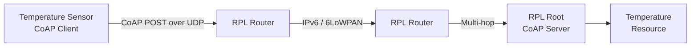
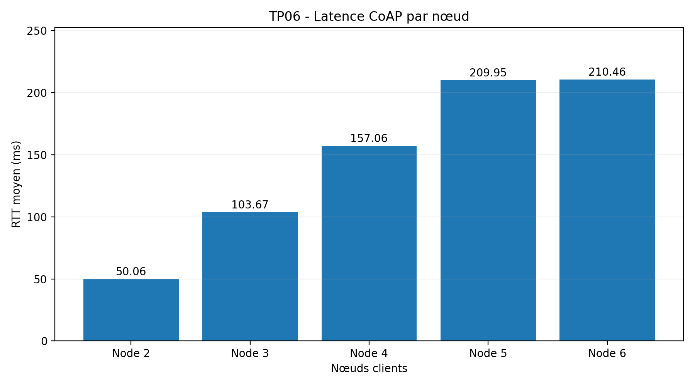
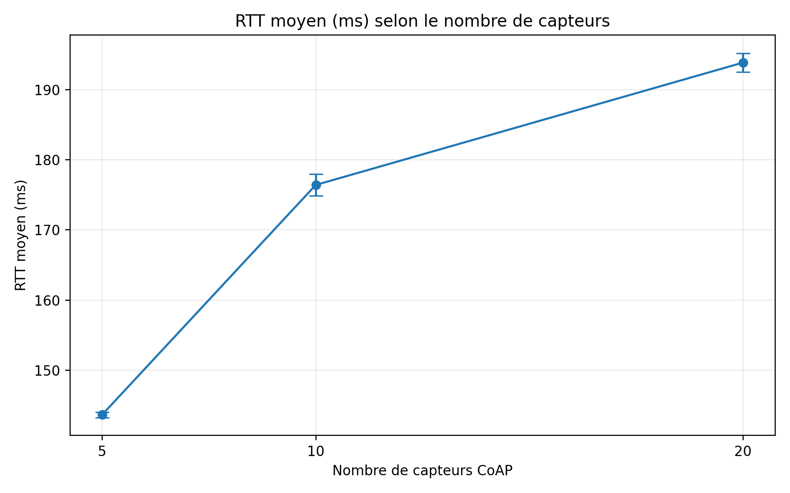
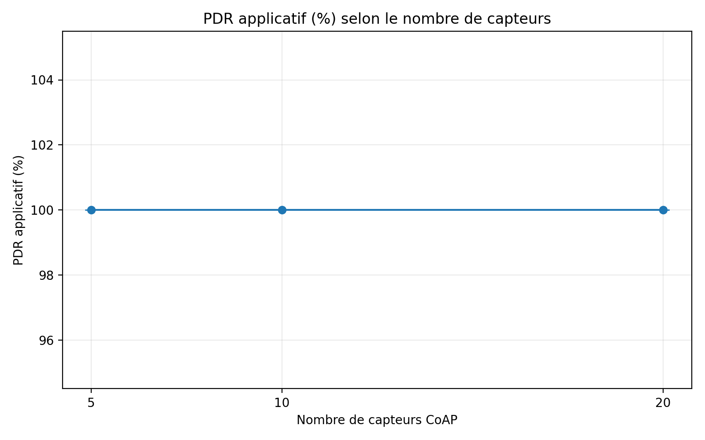
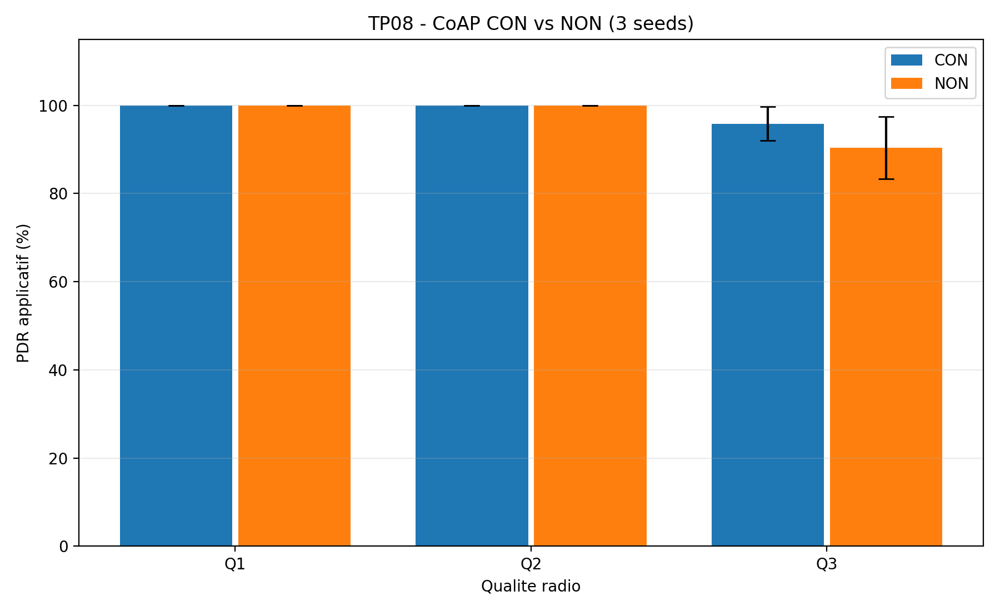
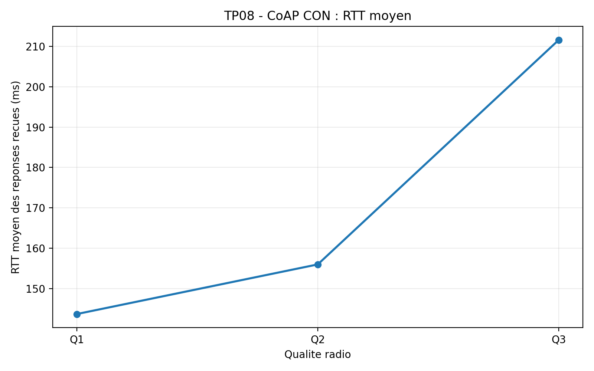

# CoAP Performance Evaluation in RPL/6LoWPAN IoT Networks

**An experimental study of multi-hop communication, scalability,
and CoAP reliability using Contiki-NG and Cooja.**

## Overview

This project investigates the performance of the Constrained
Application Protocol (CoAP) in IPv6-based wireless sensor networks.

The network combines:

- **CoAP:** lightweight application-layer communication over UDP.
- **RPL:** routing in low-power and lossy networks.
- **6LoWPAN:** IPv6 adaptation for constrained wireless networks.
- **Contiki-NG:** operating system for constrained IoT devices.
- **Cooja:** wireless sensor network simulation environment.

The project includes C applications, Cooja simulation configurations,
Python analysis scripts, measured results, and visual documentation.

## Research Objectives

1. Implement CoAP client/server communication.
2. Validate multi-hop communication through RPL.
3. Measure application-level delivery and round-trip time (RTT).
4. Evaluate scalability with 5, 10, and 20 clients.
5. Compare CoAP CON and NON under different radio conditions.

## Network Architecture



The implemented application periodically sends simulated temperature
measurements to the CoAP server.

**Resource:** `/sensors/temperature`

Example application payload:

`id=2,seq=0,temp=22.1`

Application logs include:

- `TEMP_TX`: message generated by the client.
- `TEMP_RX`: message received by the server.
- `TEMP_ACK`: application-level CoAP response observed by the client.

`TEMP_ACK` should not be confused with an independently measured
count of CoAP protocol-level acknowledgements or retransmissions.

## Project Structure

```text
.
├── examples/            C source code and Makefiles
├── simulations/         Cooja simulation configurations
├── analysis/            Python analysis scripts
├── results/
│   ├── csv/             Experimental data
│   └── figures/         Performance plots
├── docs/
│   └── screenshots/     Original Cooja screenshots
├── scripts/             Installation utilities
├── presentation/        Presentation materials
└── README.md
```

## Experimental Methodology

### Multi-hop Latency — TP06

Five CoAP clients communicate with a root/server through
a multi-hop wireless topology.

The study measures RTT and application-level message delivery.

### Scalability — TP07

Three network sizes were evaluated:

| Scenario | CoAP clients |
|---|---:|
| S1 | 5 |
| S2 | 10 |
| S3 | 20 |

Three random seeds were used:
`12345`, `23456`, and `34567`.

### CON vs NON — TP08

The two CoAP message modes were compared under three
radio configurations using the Cooja UDGM radio medium.

| Condition | RX success ratio |
|---|---:|
| Q1 | 1.0 |
| Q2 | 0.9 |
| Q3 | 0.5 |

Each combination was repeated with three random seeds,
resulting in 18 simulations.

The radio configuration parameter is not equivalent
to the measured end-to-end application packet loss rate.

## Experimental Results

### TP06 — Multi-hop Latency

- Application records: **13,334**
- Messages received by server: **13,333**
- Client responses observed: **13,333**
- Mean RTT of completed exchanges: **146.11 ms**

The final transmission was recorded immediately before
the capture ended. Its delivery status is unknown, so it
is not classified as a confirmed packet loss.



### TP07 — Scalability

| Clients | Mean RTT | PDR | Response success |
|---|---:|---:|---:|
| 5 | 143.67 ms | 100% | 100% |
| 10 | 176.41 ms | 100% | 100% |
| 20 | 193.84 ms | 100% | 100% |

The mean RTT increases as the number of clients grows,
while application delivery remains at 100% under the
tested configurations.





### TP08 — CoAP CON vs NON

| Condition | CON PDR | NON PDR | CON mean RTT |
|---|---:|---:|---:|
| Q1 | 100% | 100% | 143.67 ms |
| Q2 | 100% | 100% | 155.97 ms |
| Q3 | 95.86% | 90.38% | 211.60 ms |

In Q3, CON achieved a mean PDR **5.48 percentage points**
higher than NON.

The mean PDR standard deviation across the three seeds was:

- CON Q3: **3.86 percentage points**
- NON Q3: **7.03 percentage points**





## Limitations

- Results come from simulation, not physical hardware.
- Three seeds per scenario limit statistical generalization.
- CON and NON generated different traffic volumes in Q3.
- NON RTT was not measured in this implementation.
- CoAP and MAC retransmissions were not separately counted.
- Actual RPL parent/hop relationships were not independently
  validated for every node.

The results describe the tested configurations and should
not be interpreted as universal protocol performance.

## Requirements

- Ubuntu or another supported Linux environment
- Git
- Contiki-NG
- Cooja
- Docker (optional, used in the validated environment)
- Python 3
- Matplotlib for the plotting scripts

Validated Contiki-NG commit:

`c02eedae8b187123069891f81a7111b833701f9c`

## Installation

Clone Contiki-NG and check out the validated commit:

```bash
git clone --recursive https://github.com/contiki-ng/contiki-ng.git
cd contiki-ng
git checkout c02eedae8b187123069891f81a7111b833701f9c
git submodule update --init --recursive
```

Clone this project in a separate directory.

Run the provided installer from the project root:

```bash
python3 scripts/install_into_contiki.py \
  --contiki ~/contiki-ng
```

This command only checks the installation.

To install missing files without overwriting existing files:

```bash
python3 scripts/install_into_contiki.py \
  --contiki ~/contiki-ng --install
```

The installer stops if any existing destination file conflicts
with a project file.

TP01 and TP02 depend on the original `hello-world` and
`rpl-udp` examples provided by Contiki-NG.

## Running a Simulation

Once the project is installed into Contiki-NG, launch Cooja
and open a `.csc` file from the `simulations/` directory.

For a headless test with Docker, the following command was
validated in the project environment:

```bash
cd ~/contiki-ng

mkdir -p results/github_smoke_test

sudo docker run --rm --privileged --network host \
  -v "$HOME/contiki-ng:/home/user/contiki-ng" \
  -w /home/user/contiki-ng/tools/cooja \
  contiker/contiki-ng:latest \
  ./gradlew --no-daemon run \
  --args="--no-gui \
  --contiki=/home/user/contiki-ng \
  --logdir=/home/user/contiki-ng/results/github_smoke_test \
  --random-seed=12345 \
  /home/user/contiki-ng/simulations/TP08_CON_Q1_seed12345.csc"
```

A successful run should report `TEST OK`.

In the validated local test, this scenario produced:

- `TEMP_TX`: 298
- `TEMP_RX`: 298
- `TEMP_ACK`: 298

Exact reproduction on a new machine depends on the installed
toolchain, simulation configuration, and Contiki-NG version.

## Results and Analysis

Experimental CSV files are provided in `results/csv/`.

Plots are available in `results/figures/`.

Python scripts are provided in `analysis/` and may require
running from the original Contiki-NG results directory.

## Contributors

- Bennasser Bilal
- Marghadi Sara
- Oubaha Khadija
- Madhar Wissal

**Academic supervisor:** Pr. Y. Badi

**Module:** Capteurs intelligents et réseaux de capteurs

**Institution:** Faculté des Sciences El Jadida,
Université Chouaïb Doukkali, Morocco.

## References

- [CoAP — RFC 7252](https://www.rfc-editor.org/rfc/rfc7252)
- [RPL — RFC 6550](https://www.rfc-editor.org/rfc/rfc6550)
- [6LoWPAN — RFC 4944](https://www.rfc-editor.org/rfc/rfc4944)
- [Contiki-NG Documentation](https://docs.contiki-ng.org/)
- [Contiki-NG GitHub](https://github.com/contiki-ng/contiki-ng)
